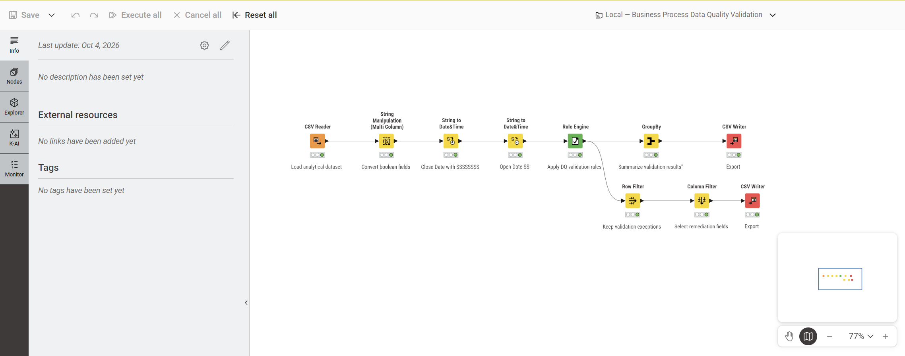
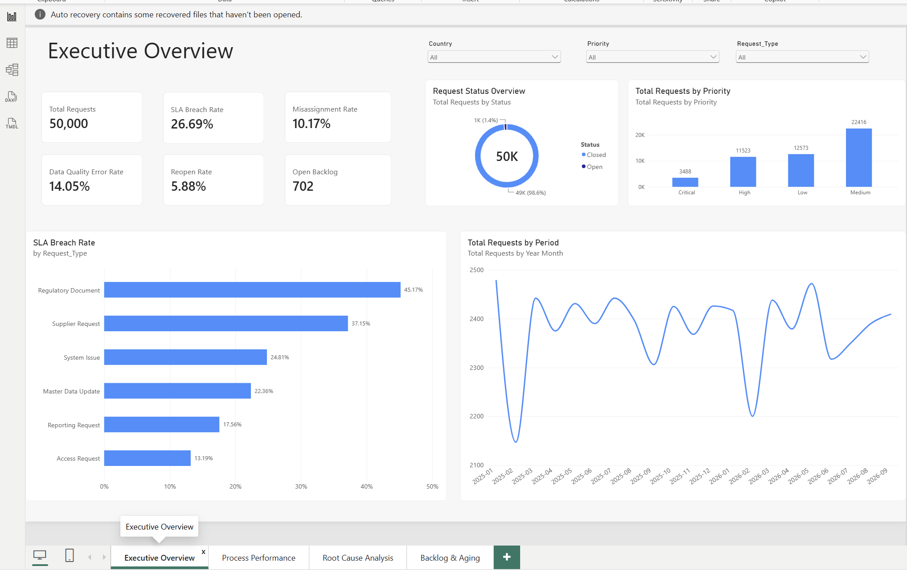
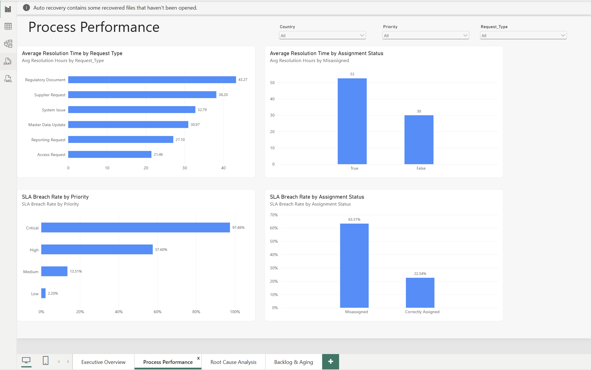
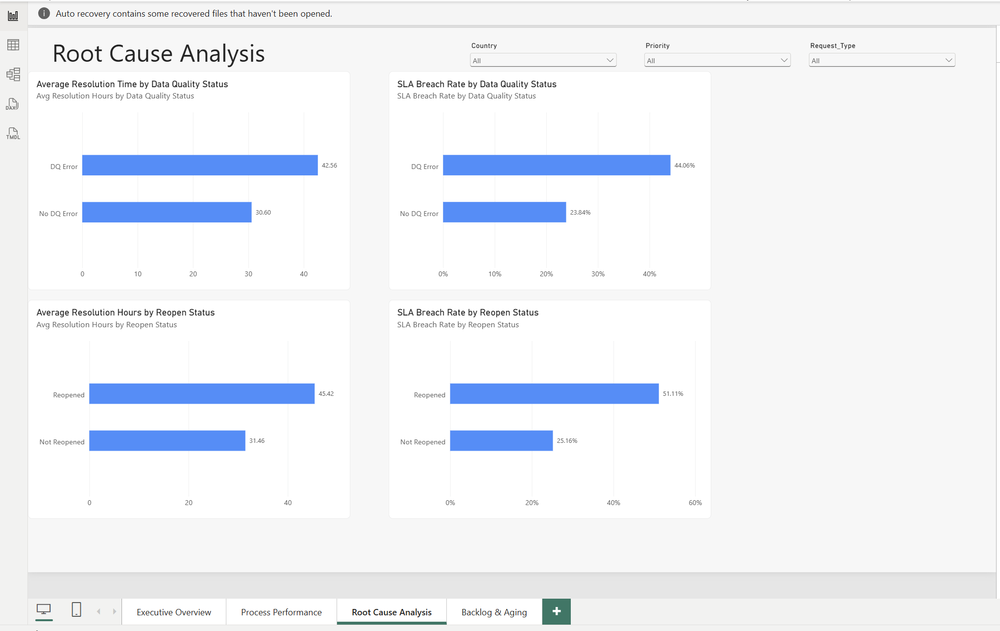
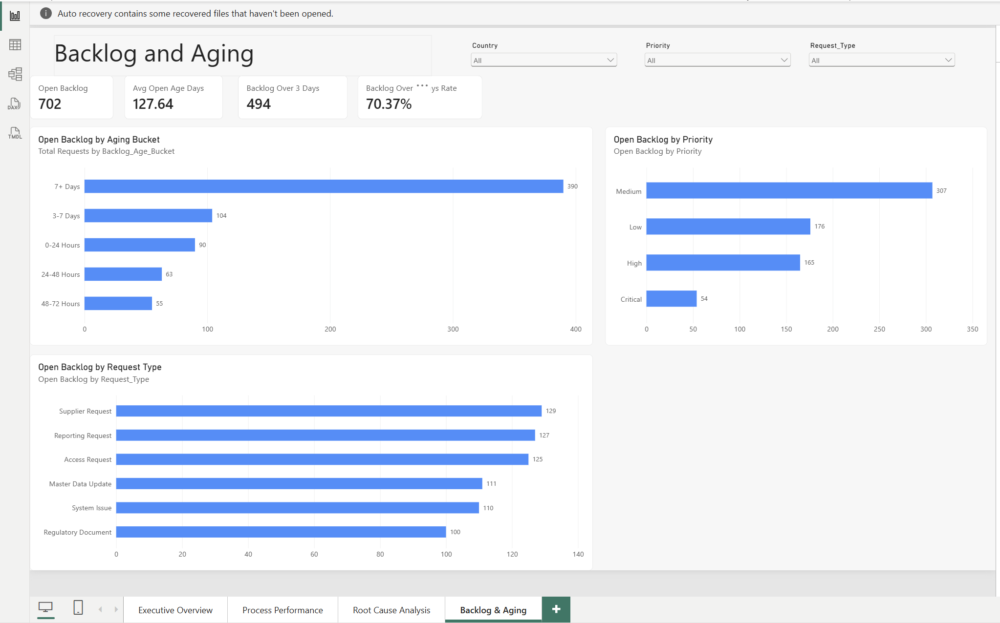

# Business Process & Data Quality Analytics

An end-to-end analytics portfolio project that simulates a business service-request environment and analyzes operational performance, SLA compliance, routing accuracy, data-quality issues, reopened requests, and backlog aging.

> **Data privacy note:** This project uses a fully synthetic dataset. It does not contain real company, employee, customer, supplier, or confidential business data.

---

## Project Overview

The objective of this project is to demonstrate an end-to-end analytics workflow using:

- **Python** for synthetic data generation, validation, and exploratory analysis
- **SQL / SQLite** for structured analytical queries and root-cause investigation
- **KNIME** for data-quality validation and exception reporting
- **Power BI** for KPI design, interactive dashboards, and business storytelling

The final dataset contains **50,000 synthetic business requests** designed to reproduce realistic operational patterns such as:

- Misassigned requests
- Data-quality errors
- Reopened requests
- SLA breaches
- Different processing times by request type and priority
- Open backlog and backlog aging

---

## Business Questions

The project was designed to answer questions such as:

1. What is the overall operational performance of the request process?
2. Which request types have the highest SLA breach rates?
3. How strongly are misassignment, data-quality issues, and reopened requests associated with poorer performance?
4. Which priority levels are most exposed to SLA breaches?
5. How large is the open backlog, and how old is it?
6. Which areas should be prioritized for process improvement or automation?

---

## Tech Stack

| Tool | Purpose |
| Python | Synthetic data generation, cleaning, validation, exploratory analysis |
| Pandas | Data manipulation and KPI analysis |
| SQLite | Local analytical database |
| SQL | Aggregation, conditional analysis, CTEs, root-cause analysis |
| KNIME | Data-quality validation workflow and exception reporting |
| Power BI | DAX measures, KPI reporting, interactive dashboards |
| Git / GitHub | Version control and portfolio documentation |

---

## Project Workflow


Synthetic Data Generation
          |
          v
Python Validation & Analysis
          |
          v
Processed Analytical Dataset
          |
          +----------------------+
          |                      |
          v                      v
       SQLite                  KNIME
          |                      |
          v                      v
     SQL Analysis        Data Quality Validation
          |                      |
          +-----------+----------+
                      |
                      v
                  Power BI
                      |
                      v
          Operational Insights & KPIs
```

---

## Dataset

The final dataset contains **50,000 synthetic requests** with fields covering:

- Request ID
- Creation date
- Country
- Requester department
- Request type
- Priority
- Correct team
- Assigned team
- Misassignment status
- Data-quality status
- Reopened status
- SLA target
- Request status
- Closed date
- Resolution time
- Request age
- SLA breach status
- Backlog aging bucket

### Final KPI Snapshot

| KPI | Result |
|---|---:|
| Total Requests | 50,000 |
| Misassignment Rate | 10.17% |
| Data Quality Error Rate | 14.05% |
| Reopen Rate | 5.88% |
| SLA Breach Rate | 26.69% |
| Open Backlog | 702 |
| Backlog Older Than 3 Days | 494 |
| Backlog Older Than 3 Days Rate | 70.37% |

---

## Synthetic Dataset Development

The dataset was developed iteratively rather than generated in a single attempt.

Early versions were tested to determine whether the resulting distributions and operational relationships were realistic enough for analysis.

One important issue identified during validation was an unrealistic backlog distribution. In an earlier version, most open requests accumulated in the oldest aging bucket because the probability of remaining open did not decrease sufficiently with request age.

The model was refined so that:

- Recent requests have a higher probability of still being open
- Older requests have a progressively lower probability of remaining open
- Backlog is distributed across multiple aging buckets
- Operational drivers such as misassignment, data-quality issues, and reopening have measurable effects on processing time and SLA performance

Historical versions are retained in:

archive/datasets_iterations/


This documents the testing and refinement process used to improve the synthetic model.

---

## Python Analysis

Python was used to:

- Generate the synthetic dataset
- Validate record counts and distributions
- Calculate operational KPIs
- Compare correctly assigned vs. misassigned requests
- Measure the impact of data-quality errors
- Measure the impact of reopened requests
- Analyze request types and priorities
- Create the cleaned dataset used by downstream tools

### Key Findings

#### Misassignment

| Assignment Status | Avg Resolution Time | SLA Breach Rate |
|---|---:|---:|
| Correctly Assigned | 29.98 h | 22.54% |
| Misassigned | 52.58 h | 63.31% |

Misassigned requests were associated with approximately:

- **+22.6 hours** average resolution time
- **+40.8 percentage points** SLA breach rate

#### Data Quality

| Data Quality Status | Avg Resolution Time | SLA Breach Rate |
|---|---:|---:|
| No DQ Error | 30.60 h | 23.84% |
| DQ Error | 42.56 h | 44.06% |

Requests with data-quality issues were associated with approximately:

- **+12.0 hours** average resolution time
- **+20.2 percentage points** SLA breach rate

#### Reopened Requests

| Reopen Status | Avg Resolution Time | SLA Breach Rate |
|---|---:|---:|
| Not Reopened | 31.46 h | 25.16% |
| Reopened | 45.42 h | 51.11% |

Reopened requests were associated with approximately:

- **+14.0 hours** average resolution time
- **+25.9 percentage points** SLA breach rate

> Because this is synthetic data, these relationships were intentionally modeled for analytical demonstration. They should not be interpreted as findings from a real production environment.

---

## SQL Analysis

The processed dataset is loaded into a local SQLite database for structured analysis.

SQL techniques used include:

- `SELECT`
- `WHERE`
- `COUNT`
- `SUM`
- `AVG`
- `ROUND`
- `CASE WHEN`
- `GROUP BY`
- `ORDER BY`
- Conditional aggregation
- Common Table Expressions (CTEs)

### Example Analytical Questions

- Which request types have the highest misassignment rates?
- How does SLA performance change when a request is misassigned?
- Which request types are most affected by data-quality errors?
- How does reopening affect SLA performance by request type?
- Which priorities have the highest SLA breach rates?

### Request Type Performance

| Request Type | Avg Resolution Time | SLA Breach Rate |
|---|---:|---:|
| Regulatory | 43.27 h | 45.17% |
| Supplier | 38.20 h | 37.15% |
| System | 32.79 h | 24.81% |
| Master Data | 30.97 h | 22.36% |
| Reporting | 27.10 h | 17.56% |
| Access | 21.46 h | 13.19% |

Regulatory and Supplier requests showed the highest overall operational pressure in the synthetic process.

---

## KNIME Data Quality Workflow

KNIME was used to create a reusable validation workflow for the processed dataset.

The workflow includes:

```text
CSV Reader
    |
    v
Boolean Conversion
    |
    v
Date / Time Conversion
    |
    v
Rule Engine
    |
    +----------------------+
    |                      |
    v                      v
 GroupBy               Row Filter
    |                      |
    v                      v
Summary Report        Exception Report
```

The validation logic classifies records into categories such as:

- `VALID`
- `DATA QUALITY ISSUE`
- `MISSING REQUIRED DATA`

The workflow identified:

- **42,974 valid records**
- **7,026 data-quality issue records**

### KNIME Workflow



---

## Power BI Dashboard

The Power BI report contains four analytical pages.

### 1. Executive Overview

Provides the main operational KPIs and high-level performance trends.



### 2. Process Performance

Focuses on resolution time, request type, priority, and assignment performance.



### 3. Root Cause Analysis

Compares operational performance across:

- Data-quality status
- Reopen status
- Assignment status



### 4. Backlog & Aging

Analyzes the open backlog, aging distribution, request type, and priority.



---

## Key Business Insights

The synthetic analysis highlights several operational patterns:

- **Misassignment is one of the strongest performance drivers**, with substantially higher resolution times and SLA breach rates.
- **Reopened requests show significant process inefficiency**, with SLA breaches increasing to more than 50%.
- **Data-quality issues create measurable downstream delays.**
- **Regulatory and Supplier requests are the most operationally demanding request types.**
- **Critical requests have a very high SLA breach rate (~97.5%)**, indicating that the modeled 8-hour SLA is significantly tighter than the simulated process capability.
- **70.37% of the open backlog is older than three days**, indicating backlog aging as a key management concern.

---

## Potential Business Recommendations

Based on the synthetic analysis, the following actions would be reasonable improvement priorities:

1. **Improve request routing**
   - Strengthen assignment rules
   - Standardize request categorization
   - Introduce automated routing where possible

2. **Reduce data-quality defects at intake**
   - Validate mandatory fields
   - Add structured forms
   - Prevent incomplete requests from entering the process

3. **Investigate reopened requests**
   - Identify common reopen reasons
   - Improve first-time-right resolution
   - Track reopening as a process-quality KPI

4. **Review SLA design**
   - Compare SLA targets with actual process capability
   - Investigate whether Critical requests require dedicated routing or capacity

5. **Prioritize aged backlog**
   - Introduce aging thresholds
   - Escalate long-open requests
   - Monitor backlog older than three days as an operational KPI

---

## Repository Structure

```text
business-process-analytics/
|
├── archive/
│   └── datasets_iterations/
│       ├── generate_data_v1.py
│       ├── generate_data_v2.py
│       └── ...
|
├── data/
│   ├── raw/
│   └── processed/
|
├── scripts/
│   ├── generate_data.py
│   ├── analyze_data.py
│   ├── load_to_sqlite.py
│   └── run_sql.py
|
├── sql/
│   ├── analysis_queries.sql
│   └── analytics.db
|
├── knime/
│   └── Business_Process_Data_Quality_Validation.knwf
|
├── powerbi/
│   └── Business_Process_Analytics.pbix
|
├── images/
│   ├── powerbi_executive_overview.png
│   ├── powerbi_process_performance.png
│   ├── powerbi_root_cause_analysis.png
│   ├── powerbi_backlog_aging.png
│   └── knime_data_quality_workflow.png
|
└── README.md
```

---

## How to Run the Project

### 1. Generate the synthetic dataset

```powershell
python .\scripts\generate_data.py
```

### 2. Run the Python analysis

```powershell
python .\scripts\analyze_data.py
```

### 3. Load the processed dataset into SQLite

```powershell
python .\scripts\load_to_sqlite.py
```

### 4. Run the SQL analysis

```powershell
python .\scripts\run_sql.py
```

### 5. KNIME

Open the workflow located in:

```text
knime/Business_Process_Data_Quality_Validation.knwf
```

### 6. Power BI

Open:

```text
powerbi/Business_Process_Analytics.pbix
```

---

## Development Note

This project was **developed with AI assistance** for activities such as brainstorming, debugging support, code review, explanation of technical concepts, and documentation refinement.

The project structure, analytical decisions, testing, validation, interpretation of results, and final implementation were reviewed and executed by the project author.

AI assistance is disclosed for transparency. 
---

## Skills Demonstrated

- Data generation and validation
- Python / Pandas
- SQL and SQLite
- Data-quality analysis
- KNIME workflow development
- Power BI and DAX
- KPI design
- Root-cause analysis
- Process-performance analysis
- Data visualization
- Business storytelling
- Analytical documentation
- Iterative model validation

---

## Author

**Josue Hernandez Moya**

Portfolio project focused on business process analytics, data quality, automation opportunities, and operational performance.
